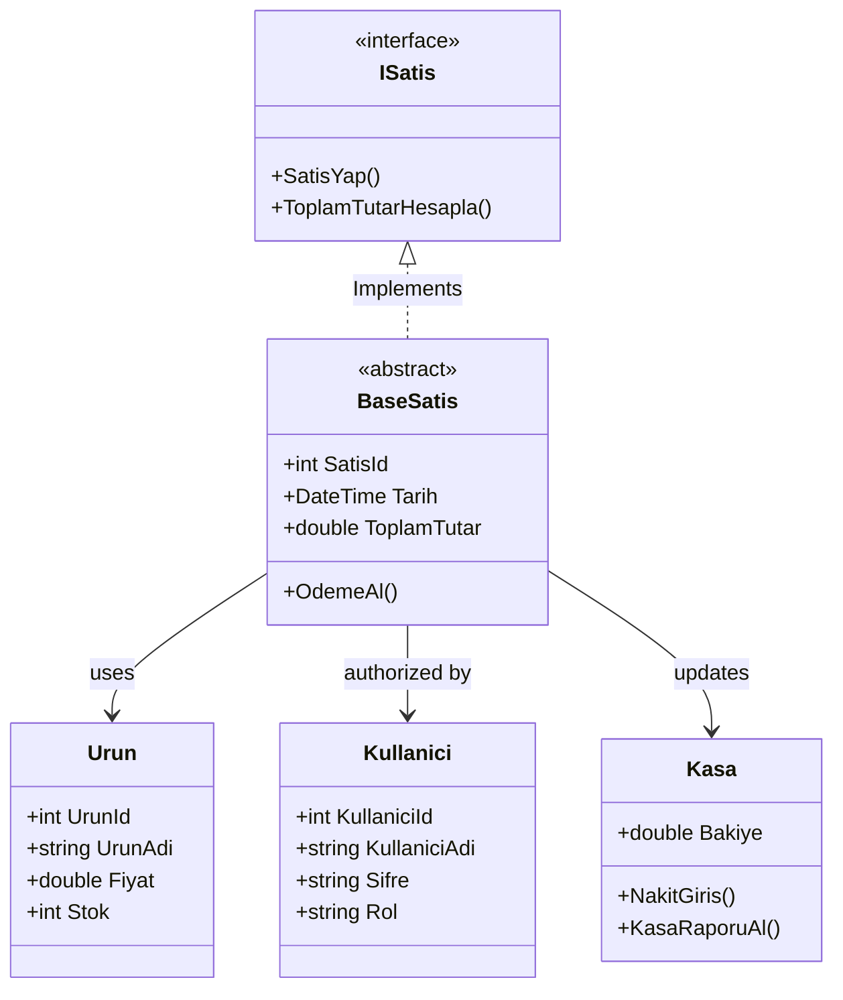
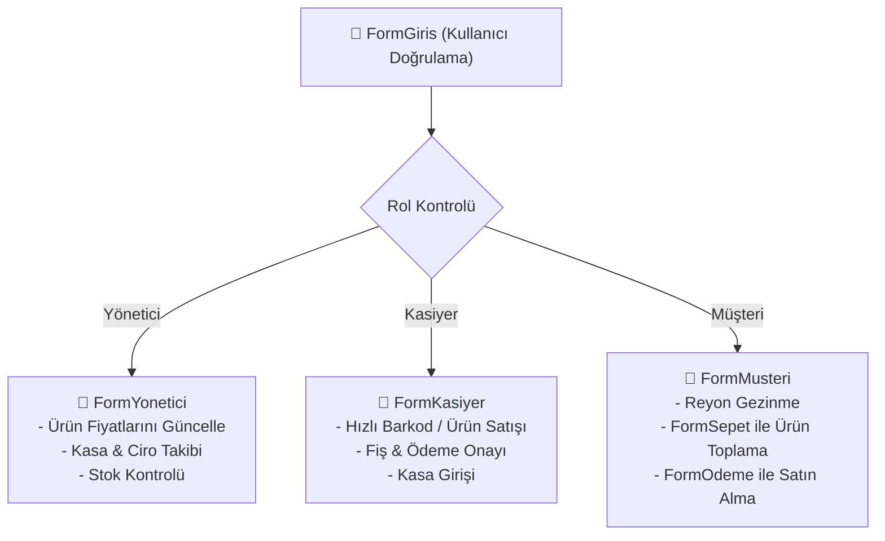

# 🛒 Market Yönetim ve Satış Otomasyonu (C# .NET WinForms)

[](https://learn.microsoft.com/dotnet/csharp/)
[](https://dotnet.microsoft.com/)
[](https://github.com/MertCinbar/Market_Proje)
[](LICENSE)

C# ve Nesne Yönelimli Programlama (OOP) prensipleri kullanılarak geliştirilmiş; **Katmanlı Mimari (Class Library)** yapısına sahip, rol bazlı yetkilendirme (Yönetici, Kasiyer, Müşteri) ve dinamik sepet/kasa yönetimini içeren kapsamlı bir masaüstü otomasyon sistemidir.

---

## 🌟 Öne Çıkan Özellikler

- 👥 **Rol Bazlı Kullanıcı Girişi (`FormGiris`):**
  - **👑 Yönetici (Admin):** Ürün stok ve fiyat güncelleme, kasa durumunu izleme ve ciro denetimi.
  - **💼 Kasiyer:** Hızlı satış ekranı, müşteri sepetini kasadan geçirme, ödeme alma ve fiş oluşturma.
  - **🛒 Müşteri:** Reyon ürünlerini listeleme, sepet oluşturma ve ürün detaylarını inceleme.
- 🧱 **Nesne Yönelimli Programlama (OOP) ve Katmanlı Mimari:**
  - `ISatis` arayüzü (Interface) ile sözleşme tabanlı satış metotları.
  - `BaseSatis` soyut sınıfı (Abstract Class) ile kod tekrarını önleyen kalıtım yapısı.
  - Model sınıfları (`Urun`, `Kullanici`, `Siparis`, `Kasa`, `Fiyatlar`) ile yüksek kapsülleme (Encapsulation).
- 💳 **Dinamik Sepet ve Ödeme Modülü (`FormSepet`, `FormOdeme`):**
  - Ürün adet artırma/azaltma, anlık KDV ve toplam tutar hesaplama, para üstü ve kasa güncelleme.

---

## 🏗️ Katmanlı Mimari ve Sınıf Şeması

Proje, iş mantığını (`ClassLib`) kullanıcı arayüzünden (`MarketProje`) tamamen izole eden **N-Tier (Çok Katmanlı)** bir yapıdadır:



---

## 🔄 Rol Bazlı Kullanım Akışı



---

## 📁 Proje Dosya Yapısı

```text
Market_Proje/
├── MarketProje.sln             # Visual Studio Solution Çözüm Dosyası
├── ClassLib/                   # İş Mantığı ve Veri Modeli Katmanı
│   ├── ISatis.cs               # Satış Interface tanımı
│   ├── BaseSatis.cs            # Abstract temel sınıf
│   ├── Urun.cs                 # Ürün entity sınıfı
│   ├── Kullanici.cs            # Kullanıcı ve yetki modelleri
│   ├── Kasa.cs                 # Kasa ve bakiye operasyonları
│   ├── Siparis.cs              # Sipariş nesnesi
│   └── Fiyatlar.cs             # Fiyat yönetimi
└── MarketProje/                # Windows Forms Arayüz Katmanı
    ├── FormGiris.cs            # Kullanıcı login penceresi
    ├── FormYonetici.cs         # Yönetici yönetim ekranı
    ├── FormKasiyer.cs          # Kasiyer hızlı satış ekranı
    ├── FormMusteri.cs          # Müşteri alışveriş ekranı
    ├── FormSepet.cs            # Sepet ve tutar paneli
    └── FormOdeme.cs            # Ödeme alma penceresi
```

---

## 🛠️ Nasıl Çalıştırılır?

1. **Gereksinimler:** Visual Studio 2019 / 2022 (.NET Desktop Development iş yükü ile).
2. **Çalıştırma:**
   - `MarketProje.sln` dosyasını Visual Studio ile açın.
   - Çözümü Derleyin (`Build Solution` - `Ctrl+Shift+B`).
   - `F5` tuşuna basarak projeyi başlatın.

---

## 📜 Lisans

Bu proje eğitim ve portföy amaçlı açık kaynak olarak sunulmuştur.

**Geliştirici:** [Mert Çinbar](https://github.com/MertCinbar)  
*Muğla Sıtkı Koçman Üniversitesi - Bilişim Sistemleri Mühendisliği*
